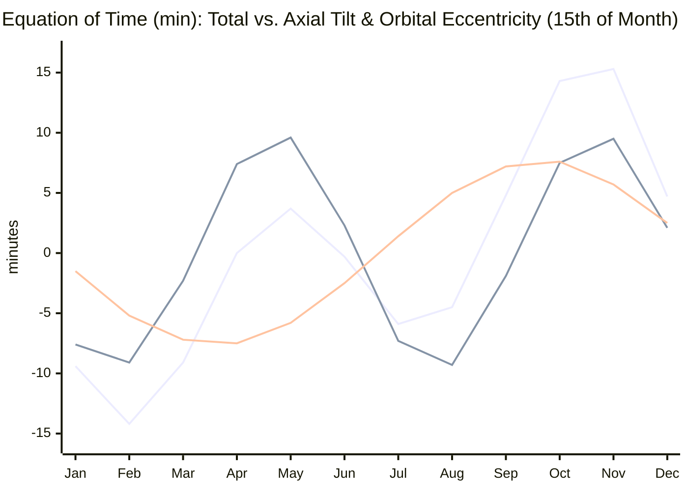
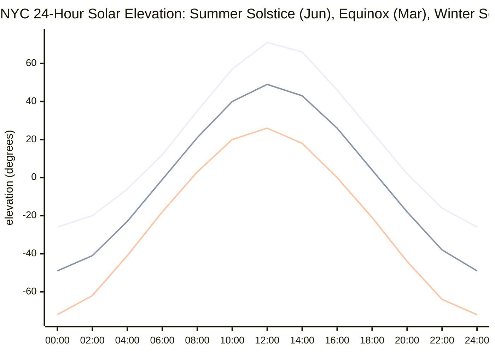

# Noon

CLI utility that reports sunrise, solar noon, and sunset for any city in the bundled dataset using a Rust port of the NOAA Solar Position Algorithm.

## Prerequisites

- Rust 1.78+ (edition 2024)

## Usage

```bash
cargo run --                            # sunrise/noon/sunset for today in NYC
cargo run -- San Francisco              # different city (auto-detected country)
cargo run -- --date 2025-12-21 "Paris, FR" # explicit city + ISO country code + date
```

The program prints the local sunrise, solar noon, and sunset timestamps along with a 24-hour solar elevation arc showing the sun's altitude across the day, markers for sunrise (`▲`), solar noon (`●`), sunset (`▼`), and the current sun position (`◉`) when viewing today's date:

```text
Solar events for New York City, US on 2025-06-21 in America/New_York:
  Sunrise: 05:25:01 (EDT)
  Solar noon: 12:57:50 (EDT)
  Sunset: 20:30:39 (EDT)

  +90° ┤                                                
       │                       ••●••                    
  +60° ┤                    •••     •••                 
       │                 •••           ••               
  +30° ┤               ••                •••            
       │           ••••                     ••••        
    0° ┼──────────▲─────────────────────────────▼───────
       │    ······                               ·····  
  -30° ┤····                                          ··
       │                                                
  -60° ┤                                                
       │                                                
  -90° ┤                                                
       └─────┴─────┴─────┴─────┴─────┴─────┴─────┴─────┴
     00:00 03:00 06:00 09:00 12:00 15:00 18:00 21:00 24:00
       ▲ Sunrise  ● Solar noon (+72.7°)  ▼ Sunset  •  Daylight: 15h 05m
```

## Implementation Notes

- `src/solar.rs` implements the NOAA solar position series (geometric mean longitude, anomaly, obliquity correction, equation of time, etc.) and exposes `solar_noon_datetime`, `sunrise_sunset_datetimes`, and `solar_elevation_degrees`.
- `src/viz.rs` renders the 24-hour terminal solar elevation curve with automatic ANSI color detection (respecting `NO_COLOR` and non-TTY pipes).
- `src/main.rs` is a thin CLI wrapper built on `clap` that accepts `--date YYYY-MM-DD` plus a city name and prints all three solar events along with the elevation chart.
- `src/solar.rs` and `src/viz.rs` contain regression tests that pin representative seasonal dates (noon, sunrise, sunset, elevation, and chart rendering) to reference values.

## Mathematical Background

The solar-noon minute value is computed via

$$
t_\mathrm{noon} = \bigl(720 - 4\lambda - \text{EoT}(T) + 60\,\Delta_\mathrm{tz}\bigr) \bmod 1440,
$$

where:

- $\lambda$ is longitude in degrees (NYC uses $-74.006^\circ$),
- $\Delta_\mathrm{tz}$ is the timezone offset in hours on the target day,
- $\text{EoT}(T)$ is the equation of time in minutes, derived from

$$
\text{EoT} = 4 \cdot \frac{180}{\pi} \left[
y \sin(2L_0) - 2e\sin M + 4ey \sin M \cos(2L_0) - \frac{1}{2} y^2 \sin(4L_0) - \frac{5}{4} e^2 \sin(2M)
\right],
$$

with:

$$
y = \tan^2 \frac{\varepsilon}{2}, \qquad
L_0 = \text{mean solar longitude}, \qquad
M = \text{mean anomaly}, \qquad
e = \text{orbital eccentricity}, \qquad
\varepsilon = \text{corrected obliquity}.
$$

Sunrise, sunset, and the 24-hour elevation curve follow from the spherical law of cosines for solar altitude $\alpha$ at latitude $\phi$, solar declination $\delta = \arcsin(\sin\varepsilon \sin\lambda_\odot)$, and hour angle $H = (t - t_\mathrm{noon}) / 4$:

$$
\sin\alpha = \sin\phi\sin\delta + \cos\phi\cos\delta\cos H.
$$

Setting the sunrise/sunset zenith angle to $\theta_z = 90.833^\circ$ ($\alpha = -0.833^\circ$) yields the half-day hour angle $\omega_0$:

$$
\cos\omega_0 = \frac{\cos(90.833^\circ) - \sin\phi\sin\delta}{\cos\phi\cos\delta}, \qquad
t_{\mathrm{sunrise},\,\mathrm{sunset}} = t_\mathrm{noon} \mp 4\omega_0.
$$

Each of those quantities is computed using the same series expansions NOAA publishes for the solar position model.



The three curves above show the **total Equation of Time** alongside its two underlying components: **axial tilt** ($\varepsilon$, a 6-month cycle peaking in May/Nov and dipping in Feb/Aug) and **orbital eccentricity** ($e$, a 12-month cycle dipping in spring and peaking in autumn). Positive values mean apparent solar time is ahead of mean solar time, so a sundial reaches noon before a uniform clock does; negative values mean the apparent Sun lags behind the clock. In February and October/November the two waves have the same sign and reinforce each other ($-14.2$ min and $+15.3$ min), while in mid-April ($+7.4$ vs. $-7.5$) and mid-June ($+2.3$ vs. $-2.5$) they cancel out and cross zero.



As solar declination $\delta$ swings from $+23.44^\circ$ (June solstice) through $0^\circ$ (equinoxes) to $-23.44^\circ$ (December solstice), the entire 24-hour elevation curve in NYC ($\phi = 40.71^\circ$) shifts vertically by $\pm 23.44^\circ$—raising the solar-noon peak from $+25.8^\circ$ in winter to $+72.7^\circ$ in summer and widening the positive-altitude daylight window from $9\text{h }15\text{m}$ to $15\text{h }05\text{m}$.

## Limitations

- Sunrise/sunset calculations use the standard $90.833^\circ$ zenith angle ($-0.833^\circ$ elevation for atmospheric refraction + solar radius) and do not model additional twilight definitions.
- No persistent caching of timezone transitions; every run queries `chrono-tz` for the applicable offset.

## Development

```bash
cargo fmt
cargo clippy
```

Run the regression suite with `cargo nextest run` (requires `cargo-nextest`) or via the flake checks below.

With Nix flakes available:

```bash
nix develop       # enter a shell with rustc/cargo tooling
nix build         # build the CLI via rustPlatform.buildRustPackage
nix flake check   # build + run tests via cargo test
```

Contributions should maintain parity with NOAA’s reference results for NYC before submission.
