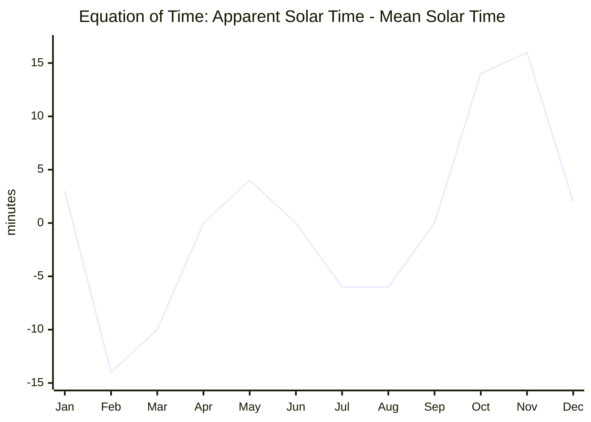

# Noon

CLI utility that reports sunrise, solar noon, and sunset for any city in the bundled dataset using a Rust port of the NOAA Solar Position Algorithm.

## Prerequisites

- Rust 1.78+ (edition 2024)

## Usage

```bash
cargo run --                            # sunrise/noon/sunset for today in NYC
cargo run -- San Francisco              # different city (auto-detected country)
cargo run -- --date 2025-12-21 "Paris, FR" # explicit city + ISO country code + date
```

The program prints the local sunrise, solar noon, and sunset timestamps along with the timezone abbreviations that apply on that date.

## Implementation Notes

- `src/lib.rs` implements the NOAA solar position series (geometric mean longitude, anomaly, obliquity correction, equation of time, etc.) and exposes `solar_noon_datetime` plus `sunrise_sunset_datetimes`.
- `src/main.rs` is a thin CLI wrapper built on `clap` that accepts `--date YYYY-MM-DD` plus a city name and prints all three solar events.
- `src/lib.rs` also contains regression tests that pin representative seasonal dates (noon, sunrise, sunset) to reference values.

## Mathematical Background

The solar-noon minute value is computed via

$$
t_\mathrm{noon} = \bigl(720 - 4\lambda - \text{EoT}(T) + 60\,\Delta_\mathrm{tz}\bigr) \bmod 1440,
$$

where:

- $\lambda$ is longitude in degrees (NYC uses $-77.006^\circ$),
- $\Delta_\mathrm{tz}$ is the timezone offset in hours on the target day,
- $\text{EoT}(T)$ is the equation of time in minutes, derived from

$$
\text{EoT} = 240 \cdot \left[
y \sin(2L_0) - 2e\sin M + 4ey \sin M \cos(2L_0) - \frac{1}{2} y^2 \sin(4L_0) - 1.25 e^2 \sin(2M)
\right],
$$

with:

$$
y = \tan^2 \frac{\varepsilon}{2}, \qquad
L_0 = \text{mean solar longitude}, \qquad
M = \text{mean anomaly}, \qquad
e = \text{orbital eccentricity}, \qquad
\varepsilon = \text{corrected obliquity}.
$$

Each of those quantities is computed using the same series expansions NOAA publishes for the solar position model.



The equation of time is easiest to read as a drift curve. Positive values mean apparent solar time is ahead of mean solar time, so a sundial reaches noon before a uniform clock does. Negative values mean the apparent Sun is behind the clock. The curve crosses zero around mid-April, mid-June, early September, and late December because the two main effects, orbital eccentricity and axial tilt, sometimes cancel and sometimes reinforce each other.

## Limitations

- Sunrise/sunset calculations use the standard -0.833° zenith (atmospheric refraction + solar radius) and do not model additional twilight definitions.
- No persistent caching of timezone transitions; every run queries `chrono-tz` for the applicable offset.

## Development

```bash
cargo fmt
cargo clippy
```

Run the regression suite with `cargo nextest run` (requires `cargo-nextest`) or via the flake checks below.

With Nix flakes available:

```bash
nix develop       # enter a shell with rustc/cargo tooling
nix build         # build the CLI via rustPlatform.buildRustPackage
nix flake check   # build + run tests via cargo test
```

Contributions should maintain parity with NOAA’s reference results for NYC before submission.***
